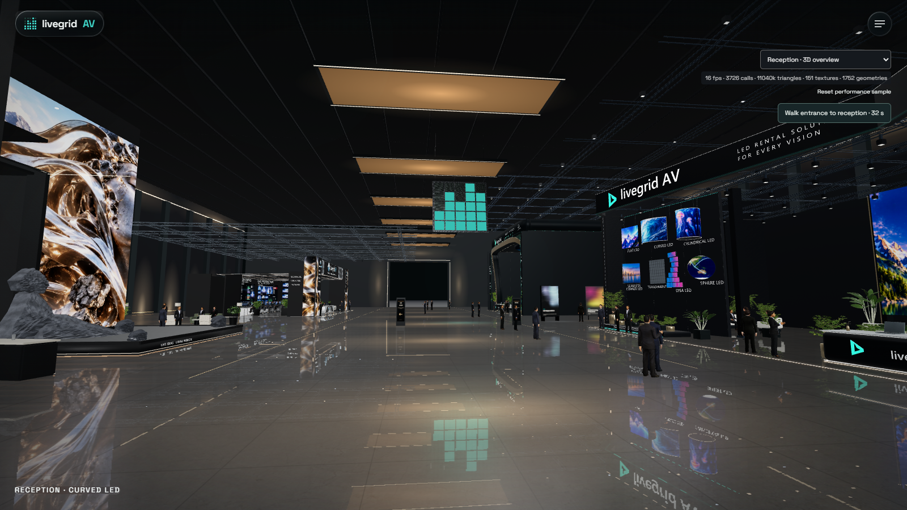
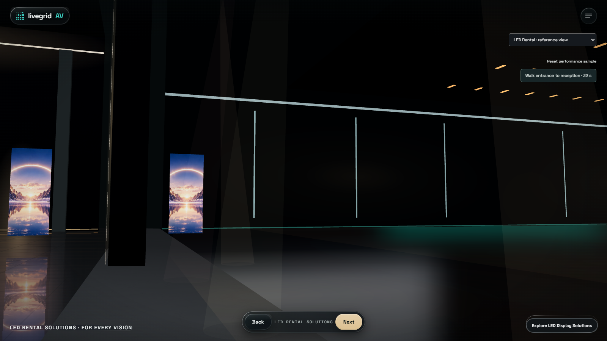
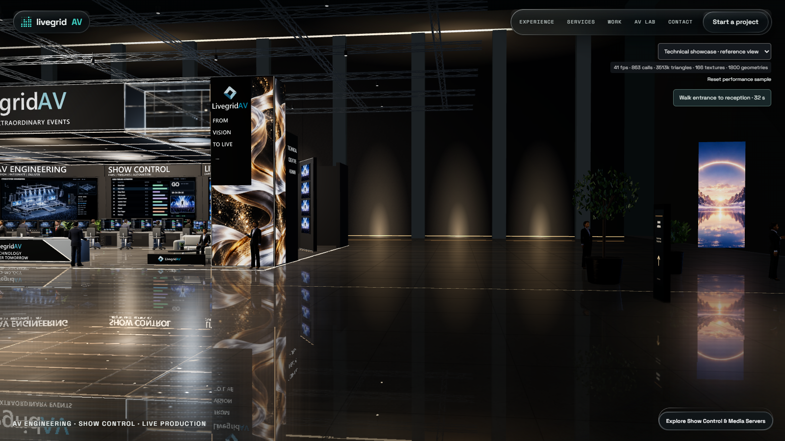
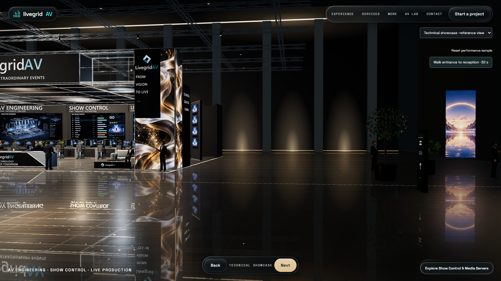
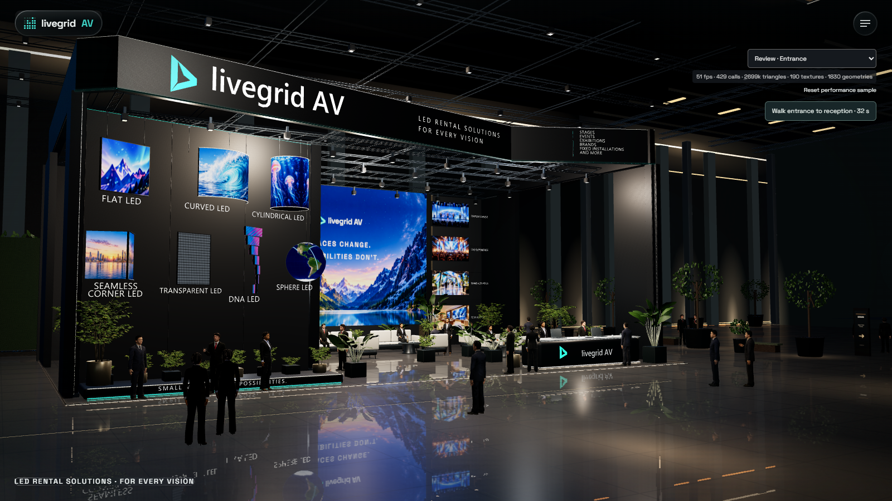
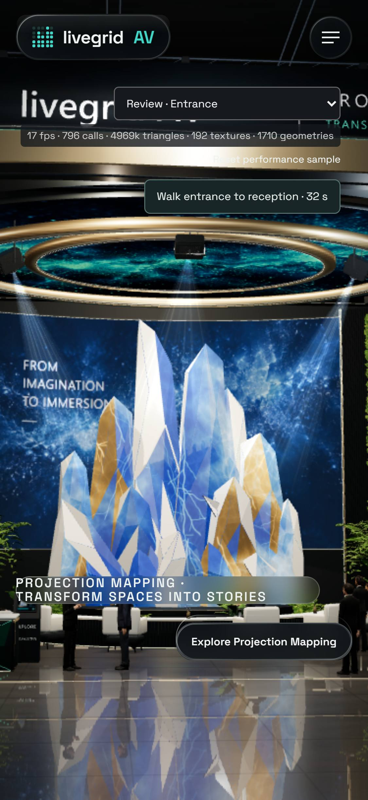
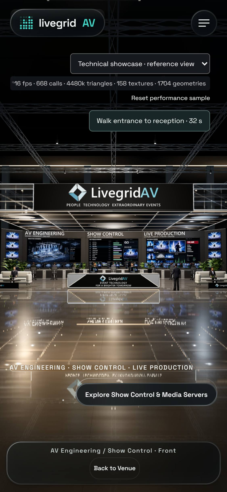
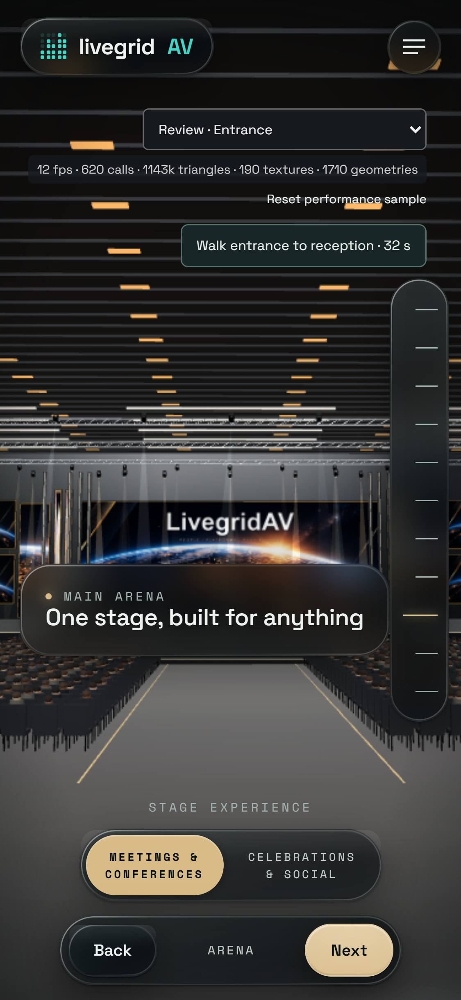

# The 3D venue: speed work, final report (November 2026)

Branch `perf/venue-speed`. Nothing here is live yet. The live site (`main`) is untouched until you say "ship".
This is the **speed stage** of your request for a venue that is "very smooth, fast loading". The WebGPU stage
comes later and gets its own plan.

## What a visitor experiences now

**Opening.** The entrance view looks exactly as it does today (your decision 2). On a typical phone connection
("Fast 4G") the venue opens after about **36 seconds**, down from about **74 seconds**. The download before the
door opens is **35 MB**, down from **77 MB**. On a weak connection ("Slow 4G") it opens after about
**2 minutes 25 seconds** (145 s; before the work about 5 minutes, estimated from the download size, not measured).

**After the door opens: no stops, no loading text, no spinner** (your decision 1). In every test run the
visitor could scroll freely from the first moment, and the words "loading" never appeared on screen.

**Open early, fill in** (your decision 3). The venue opens as soon as the entrance and a *light version* of every
other stall are ready. While the visitor walks, the full-detail stalls keep downloading in the background and
replace the light versions one by one. On Fast 4G the last stall (Projection Mapping) is in full detail about
42 seconds after opening; everything is in full detail about 79 seconds after the page was first requested.

What the light version looks like: the stall's building, furniture, plants and people are all there, in the right
place. **The stall's LED screens and artwork are dark** until full detail arrives. Picture pair below.

**Never empty space.** We checked every frame of a walk at a normal pace, every one of the 11 menu jumps right
after opening, and every stall visit: not one frame showed an area without at least its light version.

**Jumping ahead.** If a visitor uses the menu to jump straight to a far stall right after opening, they land in
the light version of that stall and it sharpens when its full version arrives: on Fast 4G that is 15 to 43 seconds
after opening, depending on the stall (Projection Mapping is the slowest, being the largest). One weakness found in
this final check: the jump asks for the *next* area's full version first instead of the one the visitor is standing
in, so the stall you jumped to does not arrive sooner than it would have anyway. Details under "Open points".

**Smoothness.** No stops, but there are still a handful of short hitches (frames that take longer than they should).
The longest ones happen when someone jumps from the very end of the venue straight back to the entrance: the
picture freezes for about a fifth of a second. During a normal walk the hitches are under a tenth of a second (in the 11 menu-jump tests, one hitch of
0.13 s was seen once, after the jump to Technical Showcase). Details under "Open points".

**Looks.** The venue looks the same as before: we compared screenshots from eight fixed camera positions before
and after, pixel by pixel. The largest difference is on the LED Rental stall (moving light beams that are never in
exactly the same position from run to run). No object moved.

## Before and after (numbers)

Measured on this computer with Chrome, cold cache (as a first-time visitor), screen 1600×900.
"Fast 4G" = 9 Mbit/s, "Slow 4G" = 2 Mbit/s, as set in the plan.

| | Before (baseline) | After (final) | Target in the plan | Met? |
|---|---|---|---|---|
| Download before the door opens | 77.1 MB (141 files) | 34.7 MB (106 files) | about 20 MB | No (see note 1) |
| Time to open, Fast 4G | 74.1 s | 36.3 s | 12 s | No (see note 1) |
| Time to open, Slow 4G | about 310 s (estimated, not measured) | 145.1 s | opens later, then no gaps | Yes |
| Everything in full detail, Fast 4G | 74.1 s (all before opening) | 78.7 s (after opening, in the background) | | |
| Frames with empty space, walk after opening | not applicable (all loaded first) | 0 of 2,304 (Fast), 0 of 10,548 (Slow) | 0 | Yes |
| Frames with empty space, 11 menu jumps right after opening | | 0 of 26,053 | 0 | Yes |
| Loading text or spinner after opening | none | none | none | Yes |
| Draw calls at the entrance (desktop, "high") | 1,239 to 1,849 | 1,203 to 1,801 | 500 or fewer | No (note 2) |
| Draw calls, worst point on the walk | 3,194 | 2,419 | 700 or fewer | No (note 2) |
| Triangles at the entrance (desktop) | 5.1 to 7.7 million | 5.2 to 7.8 million | | |
| Triangles, worst point on the walk, phone tier ("medium") | 8.67 million (measured in Task 5) | 7.5 million (phone emulation, 375×812) | 2 million | No (note 3) |
| Hitches over 50 ms after opening (Fast 4G run) | 12 (longest 151 ms) | 10 (longest 214 ms) | none | No (note 4) |
| ...of which over 100 ms | 5 | 2 (both in the end-to-entrance jump) | | |
| Looks: largest screenshot difference (0 to 255 scale, limit 1.5) | | 1.10 (LED Rental) | 1.5 or less | Yes |
| Objects moved | | 0 | 0 | Yes |

Notes:

1. **Opening size and time.** You chose to keep the entrance exactly as it is (about 24 MB for the entrance on
   its own) and to have the light version of every stall ready before opening, so the visitor never sees empty
   space (about 8 MB more; the remaining 3 MB are the page code, fonts and the like). Those two decisions set the floor at about 35 MB and about 36 seconds on Fast 4G.
   The entrance alone is ready at about 25 seconds. The plan's "12 seconds" target was never consistent with a
   20 MB opening (20 MB at 9 Mbit/s already takes about 18 seconds), and is not reachable with these decisions.
   Getting closer means making the light versions smaller (or showing the entrance before the light versions
   arrive, which would allow empty space after a fast jump).
2. **Draw calls** (how many separate drawing jobs the graphics chip gets per frame) fell 24% at the worst point,
   but are still about three times the target. Each object is drawn about four times per frame (the screen, the
   floor reflection, the shadows and one more pass), so merging objects alone cannot reach 500. The next step
   is to skip objects in the passes where they cannot be seen and to combine materials; that fits best into the
   WebGPU stage.
3. **Phone triangle count** was not worked on in this stage (the triangle target for phones needs lighter models
   on phones, which you did not choose for everyone; it remains open).
4. **Hitches.** The plan's "no hitch over 50 ms" target is not met. What is left: about six 50 to 65 ms hitches
   while the Projection Mapping stall's full version is being set up during a walk; one of about 60 ms at the
   middle of the walk; and the end-to-entrance jump (100 to 230 ms, see "Open points").

## Pictures

### Before and after (same camera, desktop)

| Place | Before | After |
|---|---|---|
| Entrance |  |  |
| LED Pillars |  |  |
| Reception |  |  |
| LED Rental |  |  |
| Content Studio |  |  |
| Technical Showcase |  |  |
| Projection Mapping |  |  |
| Arena |  |  |

### Light version, then full detail (LED Rental stall, Fast 4G: a few seconds after opening, then once its full version arrived)

| Light version | Full detail |
|---|---|
|  |  |

Menu jump to Projection Mapping right after opening: [on arrival](../final/nav-jumps/jump-projection-mapping-arrival.jpg),
[once full detail arrived](../final/nav-jumps/jump-projection-mapping-full.jpg). Every jump has the same pair in
`../final/nav-jumps/`.

### Phone (emulated: 375×812 screen, processor slowed 4×)

| Opening view | Arena, menu jump right after opening (light version) | LED Rental during the walk |
|---|---|---|
|  |  |  |
| **Projection Mapping (menu)** | **Technical Showcase, stall visit** | **Arena with reduced motion** |
|  |  |  |

All phone pictures (walk every few steps, every menu stop, every stall visit and its return, `?inspect`,
`?capture=1`) are in `../final/mobile/`. The text boxes at the top right ("Review · Entrance", the frame counter,
"Walk entrance to reception") are measurement tools that only appear with `?perf`; visitors never see them.

On the emulated slow phone the walk worked end to end with no errors and no empty space, but frames are slow
(the frame counter shows roughly 8 to 30 frames per second, and many frames take longer than 50 ms). That is
expected with the processor slowed 4×; a real phone may be better or worse.

## What was not tested

- **Real phones.** Only Chrome's phone emulation on this computer (screen size, touch, a 4× slower processor).
  A real mid-range phone has a weaker graphics chip than this computer, so hitches will be larger there.
- **Other browsers.** Only Chrome. Not Safari (iPhone), Firefox or Samsung Internet.
- **Real networks.** The 4G speeds are simulated by Chrome; real mobile networks vary more.
- **Hosting.** Tested from a local copy of the export, not from Cloudflare.

## Open points (for your decision or a later stage)

1. **Opening time** about 36 s on Fast 4G, against the plan's 12 s (note 1 above). The plan's 20 MB first
   download is also not met: 34.7 MB (entrance about 24 MB + light versions about 8 MB + page code about 3 MB).
2. **Jump priority picks the next area.** After a menu jump to Content Studio, Technical Showcase or Projection
   Mapping, the loader puts the *Arena* first (after LED Rental, Projection Mapping) instead of the stall the
   visitor is standing in. The stall still shows its light version (never empty), but it sharpens no sooner than
   without the jump. Small fix, not made in this final check.
3. **Draw calls** about 3× the target (note 2). Planned for the WebGPU stage.
4. **Phone triangles** about 4× the target (note 3).
5. **Hitches**: the end-to-entrance jump still causes one heavy frame (100 to 230 ms). We checked that this
   happens even with every stall fully loaded before opening (no background downloading at all), so it is not
   caused by the new loading; it is the graphics chip drawing the whole venue at once. The other hitches are
   50 to 65 ms (note 4).
6. **Entrance download headroom**: the entrance group is 22.7 MiB against the 24 MiB budget the tests enforce,
   so only 1.3 MiB (about 1.4 MB) is left for new entrance content before a test fails. (The earlier "entrance
   20 MiB or less" test was replaced after your decision 3.)

---

## Engineering detail

### Runs and commands

All runs against `npm run build` output at HEAD `2881565` (+ the Task 9 scripts), served by `scripts/serve-export.mjs`,
Chrome via playwright-core, `--ignore-gpu-blocklist`.

| Run | Command | Output |
|---|---|---|
| Fast 4G | `node scripts/measure-venue.mjs --label final --throttle fast4g` | `reports/perf/final/` |
| Slow 4G | `node scripts/measure-venue.mjs --label final-slow --throttle slow4g` | `reports/perf/final-slow/` |
| Look | `node scripts/compare-shots.mjs reports/perf/baseline reports/perf/final` | exit 0, worst mean 1.10 |
| Nav jumps | `node scripts/check-nav-jumps.mjs --label final --only jumps --throttle fast4g` | `final/nav-jumps-jumps.json`, `final/nav-jumps/*.jpg` |
| Stall visits | `node scripts/check-nav-jumps.mjs --label final --only visits --throttle none` | `final/nav-jumps-visits.json` |
| Fly-back | `node scripts/measure-flyback.mjs --label final --runs 3` | `final/flyback.json` |
| Phone walk | `node scripts/walk-mobile.mjs --label final` | `final/mobile/walk.json`, `final/mobile/*.jpg` |

### History (Fast 4G unless noted; long tasks = all > 50 ms observed after opening by `measure-venue`)

| Run | MB before open | Open (s) | All warm (s) | calls p=0 | max calls | max tris | long tasks (max ms) | gapFrames |
|---|---|---|---|---|---|---|---|---|
| baseline | 77.1 | 74.1 | (=open) | 1239–1849 | 3194 | 10.48 M | 12 (151) | 0 |
| t4 | 77.4 | 75.7 | | 1239–1849 | 3194 | 10.50 M | 6 (73) | 0 |
| t5 | 75.8 | 74.2 | | 1239–1849 | 3194 | 10.52 M | 5 (97) | 0 |
| t6 | 71.8 | 70.2 | | 1239–1849 | 3191 | 10.52 M | 8 (99) | 0 |
| t6b | 34.7 | 36.3 | 78.8 | 1239–1849 | 3202 | 10.50 M | 14 (254) | 0 |
| t6b-slow (Slow 4G) | 34.7 | 145.1 | 332.5 | 1239–1849 | 3194 | 10.51 M | 8 (99) | 0 |
| t7 | 34.7 | 36.4 | 79.0 | 1203–1801 | 2419 | 10.50 M | 11 (234) | 0 |
| t8 | 34.7 | 36.3 | 78.7 | 1203–1801 | 2419 | 10.50 M | 11 (206) | 0 |
| **final** | **34.7** | **36.3** | **78.7** | **1203–1801** | **2419** | **10.50 M** | **10 (214)** | **0** |
| **final-slow (Slow 4G)** | **34.7** | **145.1** | **332.4** | **1203–1801** | **2419** | **10.50 M** | **6 (133)** | **0** |

From t6b on, the long-task count includes the fly-back (an instant p = 1 → 0 jump the harness makes before the
stats walk) and the fill-in walk, which earlier runs did not have. Final long tasks after opening:
65, 54, 50, 54, 51, 59 ms at p 0.73–0.76 (fill-in walk, while projection streams and warms), 114, 73, 214 ms at
p 0.22–0.15 (fly-back), 60 ms at p 0.51 (stats walk).

### Group sizes (build output)

start 22.7 MiB (mobile 21.7), rental 9.8 (lite 1.3), anamorphic 12.3 (lite 1.5), technical 10.4 (lite 1.1),
projection 23.0 (lite 3.2), arena 1.2 (lite 0.3). Lite total 7.4 MiB. Export 856 files, 184.9 MiB, largest file under 25 MiB.

### KTX2 and the `KEEP_WEBP` list

`KEEP_WEBP = [/logo|letter|sign|brand/i]` (`scripts/encode-ktx2.mjs`): lettering, logos and signage are never
converted. In this build it matched **0** textures. 15 textures use KTX2 (9 of them `/media` files), 25 stay WebP
because their KTX2 would be larger; no cache misses.

### Fill-in timeline, Fast 4G (ms after opening; walk at 6 m/s from opening)

| group | reached | light shown | full |
|---|---|---|---|
| rental | 3,337 | 16 | 25,326 |
| anamorphic | 3,974 | 16 | 15,696 |
| technical | 9,931 | 16 | 24,994 |
| projection | 10,357 | 16 | 42,304 |
| arena | 16,739 | 16 | 35,126 |

The lite/full picture pair comes from `measure-venue`'s `--pair` camera (projection `switchOnZ` − 46 m), which
stands in front of the LED Rental stall (the pair target is picked by index, a known Task 6b minor); the rental
group was still light there, so the pair shows the rental stall.

Slow 4G (`final-slow`): opened at 145.1 s with every light version; full versions at rental 105.1 s, anamorphic
66.8 s, technical 104.8 s, projection 187.1 s, arena 154.7 s after opening; all warm at 332.4 s from the request.
0 gap frames in 10,548 fill-in frames and 0 in the stats walk; 0 loading-cue frames, no loading text. Long tasks
after opening 6: 50 (p 0), 64 (p 1), 51 (p 0.24), 133 (p 0.085, fly-back), 63 and 51 (p 0.51).
`compare-shots baseline final-slow` exits 0 (worst mean 1.12, LED Rental).

### Nav jumps right after opening (ruling: committed check, every jump)

`scripts/check-nav-jumps.mjs`: per rail stop, a fresh cold Fast 4G page; the moment the page can scroll the stop
is clicked; a per-frame monitor runs until every group is warm. "full" = seconds from the monitor start (just
before the click) until that group's full version was warm.

| Stop | p | Target | rental | anamorphic | technical | projection | arena | gap frames | long tasks (max ms) |
|---|---|---|---|---|---|---|---|---|---|
| Entrance | 0 | start | 25.0 | 15.8 | 25.3 | 42.5 | 34.9 | 0/2392 | 11 (91) |
| LED Tunnel | 0.185 | anamorphic | 24.8 | 16.6 | 25.2 | 43.4 | 36.1 | 0/2239 | 8 (74) |
| LED Pillars | 0.34 | anamorphic | 24.2 | 15.6 | 23.8 | 42.7 | 35.3 | 0/2373 | 3 (64) |
| Reception | 0.446 | technical | 24.0 | 15.2 | 23.7 | 42.3 | 34.8 | 0/2417 | 1 (59) |
| LED Rental Solutions | 0.541 | projection | 27.6 | 15.2 | 36.0 | 42.4 | 37.7 | 0/2370 | 3 (67) |
| Content Studio | 0.605 | arena | 23.6 | 15.2 | 27.5 | 42.4 | 17.1 | 0/2427 | 2 (64) |
| Technical Showcase | 0.681 | arena | 23.6 | 15.2 | 27.4 | 42.8 | 17.1 | 0/2186 | 4 (130) |
| Projection Mapping | 0.728 | arena | 23.6 | 15.3 | 27.5 | 42.5 | 17.1 | 0/2400 | 4 (67) |
| Arena | 0.865 | arena | 23.5 | 15.4 | 27.6 | 42.7 | 17.4 | 0/2416 | 3 (63) |
| Main Stage | 0.941 | arena | 23.4 | 15.2 | 27.5 | 42.4 | 17.1 | 0/2415 | 2 (55) |
| Finale | 1 | arena | 25.5 | 15.2 | 25.2 | 42.4 | 17.0 | 0/2418 | 2 (64) |

Opening in these runs: 33.7–33.8 s (the probe page's opening was not counted).

All 11: 0 gap frames, 0 loading-cue frames, 0 console errors. "Target" is `groupForZ(camera z)`, the group
`prioritizeZ` moves to the front. For LED Rental (camera z −87.65) it is `projection`; for every stop past z = −88.5
(Content Studio onward) it is `arena`, which arrives at about 17 s instead of 35 s, while the stall the camera
stands in keeps its normal place in the queue or loses a little (rental 27.6 s vs 25.3 s without a jump;
technical 27.4 s vs 25.0 s; projection 42.5 s vs 42.3 s). The prioritized `projection` after the LED Rental jump
did not arrive sooner either (42.4 s). Cause: `groupForZ` picks the last group whose
`switchOnZ` (zone start + 58 m look-ahead) the point has passed, so it returns the group *ahead* of the stall. The
plan's interface said "the group whose zone contains z"; `groups.json` carries only `switchOnZ`. This is the Task 4
deferred minor, now measured.

Stall visits (`?shot=<stall>&view=front`) open in full-load mode by design (`?view` is in `fullLoadRequested`), so
they cannot show light versions: all 5 open with every group warm, 0 gap frames, 0 errors.

### Fly-back (ruling: full-load measurement)

`scripts/measure-flyback.mjs`, unthrottled, 3 runs per mode: walk p 0 → 1 at the stats-walk pace once every group
is warm, then an instant jump to p = 0.

| Mode | Run 1 fly-back tasks (ms@p) | Run 2 | Run 3 |
|---|---|---|---|
| `full` (`?perf&capture=1`, every full group before opening, no streaming, no light packs) | 85@0.35, **206**@0.19 | 55@0.31, 69@0.23, **148**@0.18, 115@0.12 | 86@0.25, **162**@0.20 |
| `stream` (`?perf`, walk once every group is warm) | 87@0.25, **229**@0.20 | 86@0.24, **212**@0.20 | 84@0.17, 101@0.17, **129**@0.12 |

Settled: the heavy fly-back frame (148–206 ms with no streaming at all, 129–229 ms with streaming finished) is
**streaming-independent**. It is the frame(s) where the camera crosses p ≈ 0.2–0.12 at speed and the GPU draws
zones that were culled a moment before; open target, not chased here. The stats-walk task at p ≈ 0.51
(50–100 ms) also appears in both modes. A first run of this script overlapped other local work and is not used
(its numbers were in the same range: full 100–197 ms, stream 114–228 ms).

### Phone emulation walk (Step 3)

`scripts/walk-mobile.mjs`: 375×812 at dpr 3, touch, Android Chrome UA, `Emulation.setCPUThrottlingRate {rate: 4}`,
unthrottled network, cold cache.

| Pass | Opened | Gap frames | Loading cue | Console errors | Long tasks (max ms) | Checks |
|---|---|---|---|---|---|---|
| walk `?perf` (menu jump to Arena right after opening and back; walk p 0→1 at 0.02/250 ms; all 11 menu stops) | 18.2 s | 0/2825 | 0 | 0 | 603 (324) | all 11 menu stops arrived at their p; Arena jump landed with every group shown (rental, anamorphic, technical full; projection, arena light) |
| reduced motion | 8.7 s | 0/232 | 0 | 0 | 88 (392) | `prefers-reduced-motion: reduce` matched; Arena and Entrance menu jumps arrived |
| 5 stall visits + "Back to Venue" | 11.5–11.9 s | 0/505 | 0 | 0 | 211 (333) | visit bar shown and returned to the venue for all 5 |
| `?inspect=placement` | 21.0 s | 0/51 | 0 | 0 | 56 (917) | inspection status reached "ready" |
| `?capture=1` | 21.1 s | 0/97 | 0 | 0 | 3 (195) | UI hidden (`data-capture=true`) |

Walk on the phone tier (the site picks "medium" for a touch screen on this 20-core machine): draw calls up to
1,615, triangles up to 7.50 M. Long tasks are dominated by the 4× CPU throttle; they are not comparable with the
desktop numbers. Observation (not from this branch): in `?perf&capture=1` the `?perf`-only entrance review panel
keeps its "Loading preview" checkbox and loop text visible (capture mode hides only buttons and selects); visitors
never see that panel.

### Other checks

- `npm test` 78/78, `npm run typecheck` clean, `npm run build` clean.
- ESLint: full repo 184 errors (baseline 184). The branch had added the vendored three.js Basis transcoder
  (`public/basis/basis_transcoder.js`, byte-identical to `three/examples/jsm/libs/basis/`), which brought 2 errors
  (`require()` in Emscripten glue); it is now in `globalIgnores` as vendored code. Changed files: 0 errors.
- Snapshots: 1,263 named nodes before; 650 still exist by name after Task 7's merging (613 merged into combined
  meshes, by design). Of the shared nodes, 0 static nodes moved by more than 1 mm. The only differences are
  walking hall guests and the rotating LED models in the rental pavilion, which also differ between two runs of
  the same build (animation, skipped).
- Baselines re-captured on this branch: only `reports/perf/baseline` itself (Task 1, with a frozen clock for
  deterministic shots, before any speed change). The path-keyed placement baselines under
  `reports/placement-implementation/` were **not** re-captured.
- `verify-*` scripts: `verify-grand-stalls`, `verify-studio-shape-v2`, `verify-rearrangement-fit` pass.
  `verify-placement-protection`, `verify-projection-finish-v2`, `verify-rearranged-arena-path` and
  `verify-rearrangement-arena` fail on `main` already (frozen 2026-10 source baselines); the branch adds no new
  failure to the first three. `verify-rearrangement-arena` has one branch-only failure, "Basin native
  material/reflection/mesh behavior unchanged": a source-text comparison that sees Task 5's lite-mode wrapper
  around `BasinWater` (the full basin code is unchanged; in lite mode no reflection target is made).
  The protected source GLB checks pass.
